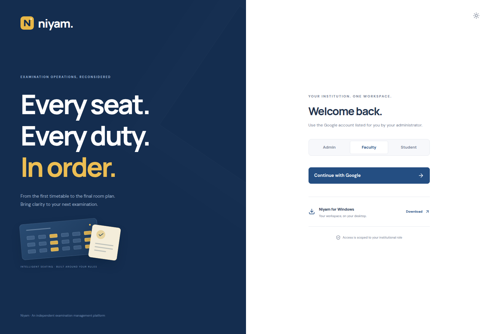
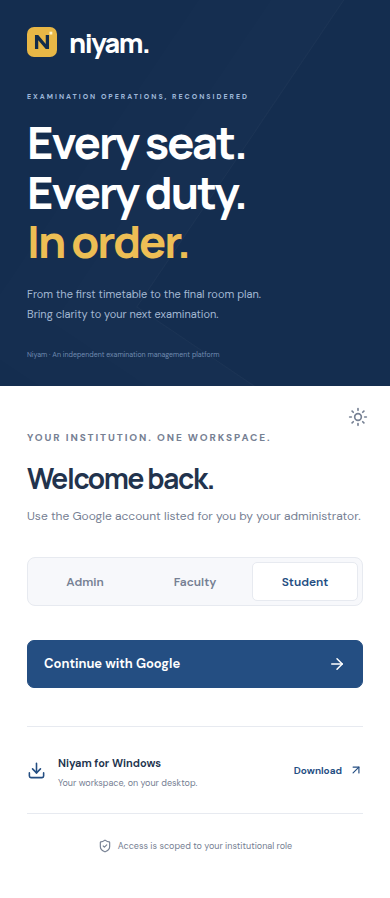

# Niyam

Niyam is an examination management platform for academic institutions. Administrators schedule exams, allocate seats and invigilation duties, and publish assignments for faculty and students.

[Open Niyam](https://niyam-exams.onrender.com) · [Download the desktop app](https://github.com/imsayon/niyam/releases/latest)

