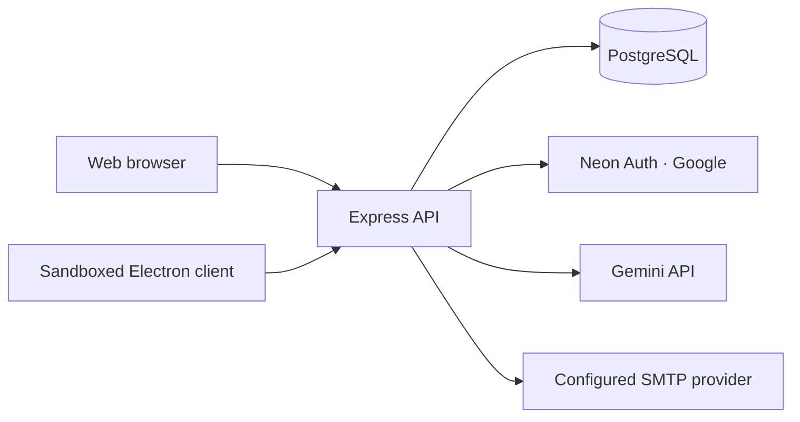

# Niyam

Niyam manages examination events, candidate enrollment, rooms, invigilation duties, and published student seating. The website and Electron desktop clients use one Express API and persistent PostgreSQL database.

The evaluation release uses synthetic records. The seeded exam has 120 candidates in semesters 3, 5, and 7, twelve faculty, and three rooms. All records are stored in the database and editable through authenticated operations.

## Open the application

- Website — https://niyam-exams.onrender.com
- Source — https://github.com/imsayon/niyam
- Desktop releases — https://github.com/imsayon/niyam/releases
- Administrator — `admin.niyam@dsce.edu.in`, with a privately held password.
- Faculty and students — select your role and sign in with the Google account whose email the administrator added to the relevant roster.
- Local demo credentials — ignored `local/demo-accounts.json`, readable by the local user only. Without Neon Auth, the local seed also provisions `faculty@niyam.example` and `student@niyam.example` for testing.

The Windows installer is unsigned. The desktop client requires an internet connection and displays the same hosted workspace as the browser. Render's free service sleeps after inactivity. Its first request may take about a minute to wake. The PostgreSQL database runs on a separate Neon free project and persists through app restarts.

## Run locally

Use Node 24 and Docker. Run `docker compose up -d --wait`, copy `.env.example` to `.env`, run `npm ci`, then `npm run seed`, `npm run build`, and `npm start`. Open http://127.0.0.1:4317.

The seed command generates random demo passwords and a server encryption key under ignored local configuration. It seeds an empty workspace and provisions missing demo accounts without replacing existing operational data or account passwords.

For frontend development, run `npm run dev` in a second terminal. Set `DEV_ORIGIN=http://localhost:5173` in the API environment to allow development requests. The dev server proxies the API to port 4317.

## Firebase emulator

The separate Niyam Firebase project has project ID `proctor-flow` and uses Spark. Run the Firebase version against the loopback Emulator Suite under `demo-niyam-local`. The public demo currently runs on Render.

With Node 22 LTS and Java 21 or later, run `npm ci`, `npm run build:firebase`, and `npm run emulators`. In a second terminal, run `npm run seed:firebase`, then open http://127.0.0.1:5000. The seed provisions the ISE demo admin and adds synthetic records to an empty workspace. The login is for the loopback demo only.

Run `npm run test:firebase` with those emulator ports free. It starts its own Auth, Firestore, and Functions emulators. Keep real documents and emulator exports local. The shipped Firestore rules are for the emulator. Preserve legacy rules when preparing any future hosted migration.

### Review uploaded records

Use **Import records** or the attachment button in **Ask Niyam**. The import review detects supported records from file contents, including structured Word tables. A weekly class timetable becomes course and teaching references. A dated lab roster becomes historical student references. You can search saved references on the import page after committing. PDF or plain-text documents without a recognized table need a manual mapping.

For an exam draft, use the **Official exam timetable** CSV template with the office's confirmed date and time for each paper. Give papers sharing a room and time the same sitting name. Select the event and exam room in import review, then enroll the current candidates for each paper and confirm the room layouts and faculty availability before generating allocation. Review the draft seating, timetable, and duty exports before publishing.

## Implemented workflows

- Session authentication with scrypt password hashes, hashed opaque session tokens, HTTP-only cookies, origin checks, login throttling, and server role enforcement.
- Role-specific sign-in on one page. The hosted demo permits password sign-in only for the administrator. Verified Google sign-in requires a unique match in the selected role's roster. Disabling an account or changing its roster email blocks access for the previous session.
- Password recovery is optional. Set `SMTP_URL`, `MAIL_FROM`, and `PUBLIC_ORIGIN` to activate delivery. On Render Free, use a provider-supported alternate port such as [Resend SMTPS on 2465](https://resend.com/docs/send-with-smtp), since [standard SMTP ports are blocked](https://render.com/docs/free). A verified sending domain is required. Recovery links expire after 30 minutes.
- Faculty and student CRUD, room creation and bench layout editing, paper and sitting setup, individual and bulk enrollment, availability and leave approval.
- Explicit lifecycle through draft, configured, published, completed, and archived. Published assignments remain immutable until a new reviewed revision is published.
- Deterministic seating by physical bench position, configurable semester/paper/department selectors, accessible and blocked seats, optional same-paper adjacency restrictions, room and student conflict checks.
- Duty allocation with faculty availability, approved leave and buffers, overlap checks, per-event duty caps, workload ranking, and room repetition preferences. Search uses bounded backtracking and reports infeasible or exhausted searches explicitly. It does not certify globally optimal fairness.
- CSV/XLS/XLSX parsing, Word table extraction, searchable PDF text, editable review, duplicate detection, and atomic imports of up to 250 rows. PDF extraction is limited to 30 pages and 25,000 characters. Scanned PDFs require OCR before import.
- Actual CSV/PDF timetable, seat, and duty downloads. Role restrictions apply to exports.
- Server-side Gemini chat over authorized records, encrypted BYOK configuration and connection testing, and explicit provider error states. Add your key in Settings. The default is [Gemini 3.1 Flash-Lite](https://aistudio.google.com/docs/models/gemini-3.1-flash-lite). AI chat has read-only access. It does not commit operational changes.
- Light and Dark appearance, responsive role portals, a keyboard-accessible room editor, and a tabular seating view.

## Architecture

`server/accounts.js` owns identity, sessions, and role checks. `server/workspace.js` owns validated operational commands. `server/solver.js` owns pure allocation logic. `server/outputs.js` owns reports and authorized AI context. React views reside in `web/main.jsx`, with shared form and display components.

Operational documents live in a single JSONB workspace row for this single-institution evaluation release. Every mutation locks the row and checks the expected revision. Accounts, sessions, recovery tokens, encrypted settings, and audit records use separate relational tables. This favors a small, transactional implementation at evaluation scale. A production expansion should normalize operational entities after measuring actual workload. This release supports at most 600 candidates per sitting.

Every saved allocation includes its policy, source revision, and exact identities. Publish reruns the deterministic solver and compares the persisted draft before atomically changing the published pointer. Faculty and student views derive from published runs. They never read the full workspace. Editing planning inputs makes existing drafts stale. Published history remains available.

## Configuration and deployment

Deploy `main` with Node 24, `npm ci && npm run build`, and `npm start`. Set `DATABASE_URL` to the new Niyam database, `PUBLIC_ORIGIN` to the HTTPS URL, and `AI_ENCRYPTION_KEY` to 32 random bytes encoded as 64 hexadecimal characters. Keep the encryption key in a separate secure backup.

To provision evaluation accounts at first deploy, set `DEMO_ADMIN_PASSWORD`, `DEMO_FACULTY_PASSWORD`, and `DEMO_STUDENT_PASSWORD` to independent random passwords of at least 14 characters. The server seeds only when these are configured. Render holds these values as private environment settings. Source and built frontend assets contain no demo passwords or provider keys.

Optional settings include `GEMINI_API_KEY`, `GEMINI_MODEL`, `SMTP_URL`, `MAIL_FROM`, `INSTALLER_URL`, and `INSTALLER_SHA256`. A saved encrypted Gemini configuration takes precedence over the environment key. Console inspection is available in the owner's Neon dashboard.

To enable roster-based Google sign-in, set `NEON_AUTH_URL` and an independent, randomly generated `NEON_AUTH_COOKIE_SECRET` of at least 32 characters. In Neon Auth, enable Google, disable email/password, and trust the application's `PUBLIC_ORIGIN`. The hosted demo uses Neon's shared Google client.

## Verification and releases

`npm test` runs solver regressions. Set `TEST_DATABASE_URL` to run the API integration tests in isolated temporary schemas. CI provides PostgreSQL and runs the tests and production frontend build. Windows and Linux packaging runs on release tags.

The current desktop release predates Google sign-in. The desktop authentication flow and Windows installation smoke test need an update before the next desktop release.

The Niyam repository contains the application source, CI workflows, documentation, and desktop releases. Its homepage links to the live website, which deploys directly from the same repository. The app's public download link points to the release asset and includes its SHA-256 checksum in the release metadata.

## Backups and migration

Run `node --env-file=.env scripts/backup.js` to create a consistent ignored backup with restrictive filesystem permissions. It includes operational records, account hashes, audit records, and encrypted provider settings. Session and recovery tokens are excluded. To restore into an empty database, run `node --env-file=.env scripts/backup.js restore /absolute/path/to/backup.json`. Preserve the original encryption key separately.

No ProctorFlow production data has been migrated. The original repository and deployment remain the owner's cutover source. Obtain a consistent Firebase export, reconcile identifiers and enrollment, and rehearse in an isolated database before using real institutional records. Archive the legacy project only after an approved cutover.

## Current limitations

- Email signup and recovery require SMTP configuration. Live Gemini requests require an owner-supplied key.
- Seat search is bounded. A timeout reports uncertainty and leaves publication intact. Workload ranking produces a feasible roster without proving global fairness optimality.
- Desktop releases require network access. Windows signing and macOS distribution remain pending. Linux is provided as an AppImage.
- Operational storage targets one institution and evaluation-sized datasets. Scheduled backup automation and a real college migration are future work.
- Runtime dependency auditing is part of verification. Build-tool advisories, when present, are recorded in the private verification notes and require upstream fixes or carefully tested toolchain updates.
